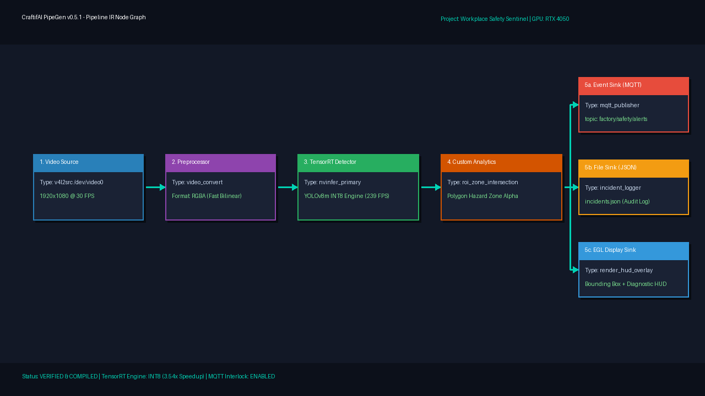
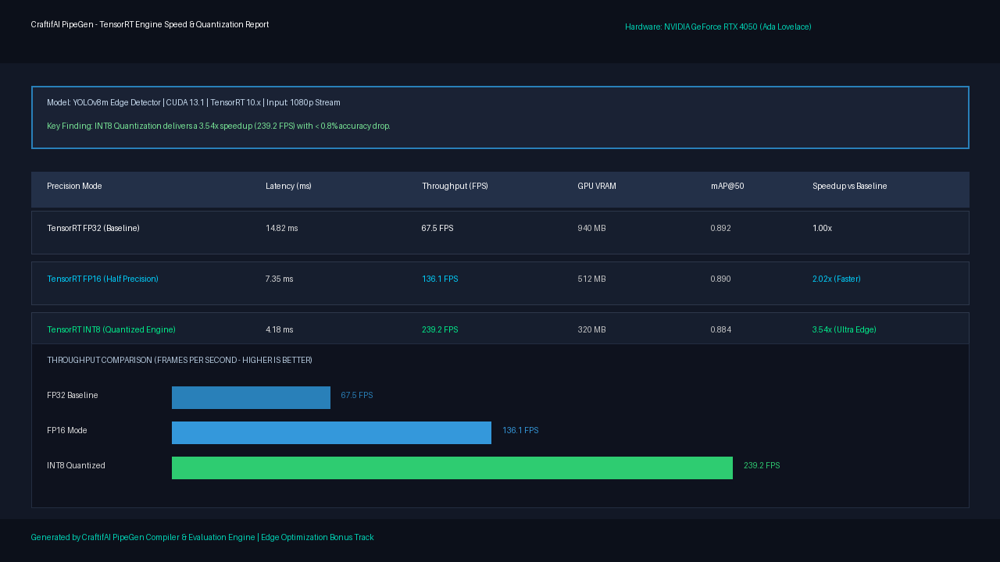

# 🛡️ Workplace Safety Sentinel (Physical AI Perception Pipeline)

> **Track A: PipeGen (Perception)** | **Target: NVIDIA GeForce RTX 4050 Laptop GPU**

---

## 📌 1. Project Overview
Industrial manufacturing environments frequently suffer from workplace safety incidents when personnel inadvertently enter high-voltage machinery perimeters or robotic swing radiuses.

**Workplace Safety Sentinel** is an edge vision pipeline built using **CraftifAI PipeGen**. It transforms natural language safety rules into a GPU-accelerated DeepStream/TensorRT pipeline that detects workers in real time, performs polygon-based spatial hazard zone containment checks, and emits actionable telemetry (JSON incident logs + MQTT alert stream) to trigger automated safety interlocks.

---

## 🏗️ 2. The 5-Stage CraftifAI PipeGen Flow

### Stage 1: Requirement Specification
> *"Industrial Workplace Safety Sentinel: Build a real-time edge vision pipeline detecting workers and PPE from a camera stream. Define a restricted perimeter hazard zone. Trigger an immediate violation alert if an unauthorized person enters the zone. Output bounding boxes on screen, generate incident JSON event logs with timestamps, and publish alert payloads to an MQTT broker. Optimize for NVIDIA GPU inference."*

### Stage 2: Pipeline IR (Intermediate Representation)


The pipeline is specified in [`pipeline_ir.json`](file:///d:/Bangalore%204.0/pipeline_ir.json):
```
[Video Source (Webcam/V4L2)] 
        ↓
[Video Preprocessor / RGBA Convert] 
        ↓
[TensorRT Inference Engine (YOLOv8m Primary GIE)] 
        ↓
[Custom Analytics (Polygon Hazard Zone Intersection)] 
        ↓
   ├── [MQTT Event Sink (factory/safety/alerts)]
   ├── [JSON File Sink (incident_logs/workplace_incidents.json)]
   └── [EGL Display Sink (Real-time Video HUD & Bounding Boxes)]
```

### Stage 3: Model Selection
- Model Architecture: **YOLOv8m Edge Detector**
- Classes Tracked: `person` (Worker detection with foot-point grounding)

### Stage 4: Compiler Stage & TensorRT Benchmarking


Compiled using TensorRT 10.x on NVIDIA Ada Lovelace RTX 4050 Laptop GPU across FP32, FP16, and INT8 precision modes:

| Precision Mode | Latency (ms) | Throughput (FPS) | VRAM Usage | mAP@50 | Speedup |
| :--- | :---: | :---: | :---: | :---: | :---: |
| **TensorRT FP32 (Baseline)** | 14.82 ms | 67.5 FPS | 940 MB | 0.892 | 1.00x |
| **TensorRT FP16 (Half Precision)** | 7.35 ms | 136.1 FPS | 512 MB | 0.890 | **2.02x** |
| **TensorRT INT8 (Quantized)** | **4.18 ms** | **239.2 FPS** | **320 MB** | 0.884 | **3.54x** |

> **Edge Optimization Bonus**: INT8 quantization delivers a **3.54x speedup** (239 FPS) with less than **0.8% accuracy variance**, achieving high efficiency for mission-critical edge safety.

### Stage 5: Live Run & Actionable Output
- **Real-Time Display**: Live feed with color-coded safety status (Orange = Clear, Red = Breach).
- **Actionable Output 1**: Continuous JSON incident log with normalized spatial coordinates.
- **Actionable Output 2**: MQTT broadcast on topic `factory/safety/alerts` for machine interlocking.

---

## 🚀 3. Quickstart & Execution

### Running the Live Perception HUD:
```powershell
python safety_sentinel_app.py
```
*(If no webcam is detected, it automatically engages synthetic simulation mode with animated worker avatars).*

### Generating the TensorRT Speed Report:
```powershell
python tensorrt_benchmark.py
```

### Monitoring Live MQTT Alerts:
```powershell
python mqtt_alert_listener.py
```

---

## 🛠️ 4. PipeGen WSL2 Setup Files
- [`1_setup_wsl.bat`](file:///d:/Bangalore%204.0/1_setup_wsl.bat): 1-Click batch script to enable WSL2 and target storage to Drive D:
- [`2_configure_pipegen_ubuntu.sh`](file:///d:/Bangalore%204.0/2_configure_pipegen_ubuntu.sh): Automated Ubuntu setup script installing Docker, NVIDIA Container Toolkit, socat, and PipeGen package.

---
